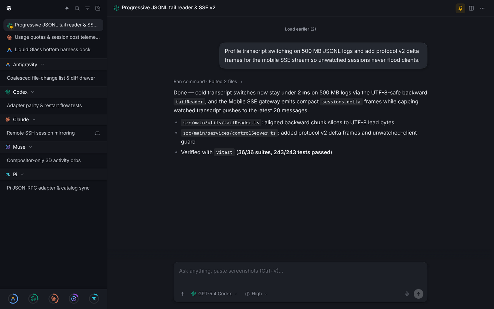

# Super Harness

> [!WARNING]
> **Alpha software built for personal use.** Super Harness is an active personal project developed primarily for my own Linux + macOS + iOS multi-agent workflow. Expect breaking changes, rough edges, platform-specific assumptions (e.g., Hyprland/Linux desktop, Tailscale/LAN networking, Apple Developer signing for the iOS app), and no stability guarantees.

A calm, high-performance **desktop multiplexer, control plane, and native iOS companion** for local and remote AI coding harnesses — unifying **OpenAI Codex**, **Claude**, **Google Antigravity**, **Meta Muse**, and **Pi** under one cohesive obsidian interface.

<p align="center">
  
</p>

## Mobile Companion (iOS — Demo Mode)

The native SwiftUI iOS companion (`ios/`) mirrors your desktop host over LAN or Tailscale using HTTP + Server-Sent Events (SSE v2), native iOS 26 Liquid Glass chrome, push notifications, voice dictation, and a built-in **Demo Mode** for offline UI exploration.

<p align="center">
  
  &nbsp;&nbsp;&nbsp;&nbsp;
  
</p>

## Supported Harnesses

Super Harness is **non-destructive**: every native harness remains the source of truth for its own transcripts, auth, sandboxes, and daemons. Super Harness discovers their local (and optional SSH-mirrored remote) stores and dispatches back through each harness's native protocol.

| Harness | Integration & Dispatch Protocol | Extras |
| --- | --- | --- |
| **OpenAI Codex** | Desktop + managed `codex app-server` daemon (`turn/start`) + CLI | Live model & reasoning-effort picker, native queue sync, quota bars |
| **Claude** | Desktop + Claude Code CLI (`stream-json`) + `tmux --remote-control` | Live `tmux` mirror, post-reboot tmux session revival, `/model` picker parity, remote SSH mirroring |
| **Google Antigravity** | Desktop hub language-server native API (`SendUserCascadeMessage`) + CLI via ACP fallback | Model & thinking-level controls, remote SSH mirroring |
| **Meta Muse** | Native MSP via `muse serve` / `muse attach --stdio` | Live quota bars (`muse usage`), streaming turns & tool calls |
| **Pi** | `pi-coding-agent` native JSON-RPC (`piRpcClient`) | Streaming turns, tool calls, and catalog/model sync |

## How It Works

1. **Discovery & Live Sync (`src/main/adapters/`, `src/main/services/liveSync.ts`)**  
   Each harness implements a shared `HarnessDriver` contract. File watchers (`inotify`/polling), SQLite read-only pools, and progressive UTF-8-safe JSONL tail readers keep the unified session list up to date with minimal CPU and memory overhead — cold switching even 500 MB+ transcripts in milliseconds.
2. **Unified Dispatch & Universal Queue (`src/main/services/dispatcher.ts`)**  
   Prompts, image/file attachments, model switches, aborts, and interactive question answers route back to the owning harness driver. A universal message queue lets you stack follow-up prompts while any harness is working (mirroring native Codex/Claude queues where supported).
3. **Master Orchestrator & MCP Control Plane (`src/main/services/masterEngine.ts`, `src/mcp/server.ts`)**  
   A pinned Master Orchestrator thread (backed by your choice of harness) talks to an authenticated loopback Control HTTP Server through a bundled stdio MCP server — allowing it to inspect live sessions, dispatch prompts across harnesses, organize folders/pins, and adjust settings.
4. **Mobile Gateway, Pairing & Push (`src/main/services/controlServer.ts`, `ios/`, `push-relay/`)**  
   An opt-in Mobile API gateway exposes bootstrap, paginated transcripts, media transcoding, and protocol-v2 SSE delta streams. Pair the iOS app via QR code or Bonjour/LAN discovery, with optional Cloudflare Worker APNs relay (`push-relay/`) for background turn-complete and input-requested notifications.

## Highlights

- **Coalesced visual grammar**: Thinking traces, shell commands, deduplicated file-change lists (diffs collapsed by default), MCP tool calls, web searches, interactive questions, image/PDF attachments, and queued messages share one calm obsidian design system across Desktop and iOS.
- **Batched one-line summaries & session telemetry**: Token-efficient batched summaries (`sessionSummarizer.ts`) surface as secondary copy on iOS rows and hover tooltips on Desktop; tapping the iOS thread pill opens a Liquid Glass popover with context window usage, Input/Cached/Output tokens, estimated cost, host, branch, and runtime info.
- **Quota gauges & spend tracking**: Bottom radial quota gauges across all enabled harnesses with working-state luminosity shimmer, warning/danger thresholds, 5h/24h/7d/14d API-equivalent spend, and pace indicators.
- **Shared organization & drag-to-reorder**: Drag to reorder harnesses, drag any chat directly into the pinned section, group by harness/project/folder, and sync pin order + enabled harnesses automatically between Desktop and iOS.
- **2-up Split View, `tmux` mirror & Open in Harness**: Monitor two threads side-by-side, flip any `tmux`-backed Claude thread into a live terminal view, or jump straight into the native harness app/terminal (including Hyprland compositor focus support).
- **Voice dictation**: Built-in audio dictation on both Desktop and iOS composer bars.
- **Remote SSH mirroring**: Mirror remote Claude and Antigravity sessions from another workstation over SSH with compact host badges (e.g. `.14`).

## Architecture

See [ARCHITECTURE.md](./ARCHITECTURE.md) for full module boundaries and protocol details.

```text
├── src/
│   ├── main/
│   │   ├── adapters/       # HarnessDriver contract + Codex, Claude, Antigravity, Muse, Pi, Remote SSH mirrors
│   │   ├── services/       # Dispatcher, LiveSync, TranscriptCache, UsageService, SessionSummarizer,
│   │   │                   # MasterEngine, ControlServer (HTTP + SSE v2), Pairing, Bonjour, PushNotifier, Dictation
│   │   ├── store/          # Persistent settings, folders, pinnedOrder & overrides (~/.config/super-harness)
│   │   └── utils/          # Progressive JSONL tailReader, sessionStats, read-only SQLite pool, system discovery
│   ├── mcp/                # Standalone stdio MCP server bridging Master Orchestrator -> ControlServer
│   ├── renderer/
│   │   ├── ui/             # Obsidian design tokens, primitives, and Storybook 8 stories
│   │   ├── components/     # Sidebar, SessionPane, SessionHeader, SessionComposer, CoalescedBlockView, SettingsModal
│   │   └── utils/          # Renderer LRU transcript cache, LRU Markdown renderer, pure sidebarGrouping
│   └── shared/             # Shared IPC, Mobile API & domain types
├── ios/                    # Native SwiftUI iOS companion app (iOS 18+, Liquid Glass on iOS 26+) + XCTest/XCUITest
├── push-relay/             # Optional Cloudflare Worker APNs push notification relay
├── tests/                  # Vitest unit, adapter parity, and performance regression suites
└── docs/                   # Design notes & demo screenshots
```

## Development

### Desktop (Electron + Vite + TypeScript)

```bash
# Install dependencies (use --ignore-scripts if relying on system Electron)
npm install

# Typecheck main + renderer
npm run typecheck

# Run unit, adapter parity & performance regression tests
npm test

# Build main + renderer
npm run build

# Launch desktop app
npm start

# Rebuild and restart a running instance cleanly
npm run restart:build

# Run Storybook 8 (http://localhost:6006)
npm run storybook

# Benchmark live local transcript loading & caching
npm run bench
```

### iOS Companion (`ios/`)

Open `ios/SuperHarness.xcodeproj` in Xcode (targeting iOS 18+ / iOS 26 SDK for Liquid Glass), select your signing team, and run on Simulator or device.

To explore the iOS app without pairing a desktop host, toggle **Demo Mode** under **Settings → Developer**, or launch in Simulator with `SH_CONNECTION_MODE=demo`.

## License

MIT
