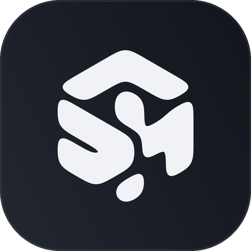
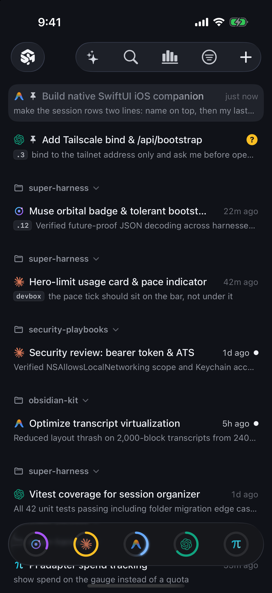
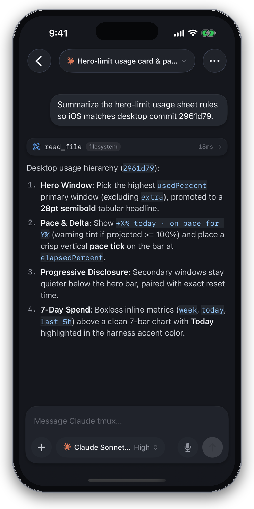

<div align="center">
  
  <h1>Superharness</h1>
  <p><strong>The unified multiplexer for all your coding harnesses and ADEs.</strong></p>
</div>

<p align="center">
  
</p>

> [!WARNING]
> **Alpha software for personal use.** Superharness is an active personal project built for my own Linux + macOS + iOS multi-agent workflow. Expect breaking changes, rough edges, and no stability guarantees.

## iPhoneApp

<p align="center">
  
  &nbsp;&nbsp;&nbsp;&nbsp;
  
</p>

## Supported Harnesses

Superharness is **non-destructive** — each harness keeps its own transcripts, auth, and sandboxes while Superharness unifies them under one interface.

- **OpenAI Codex** — Desktop, app-server daemon, and CLI
- **Claude** — Desktop, Claude Code CLI, `tmux` sessions, and remote SSH hosts
- **Google Antigravity** — Desktop, CLI, and remote SSH hosts
- **Meta Muse** — Local Muse sessions and usage quotas
- **Pi** — Local `pi-coding-agent` sessions

## Features

- **Unified transcripts**: Thinking traces, shell commands, coalesced file-change lists, tool calls, interactive questions, and attachments render in one consistent obsidian UI.
- **2-up Split View & live `tmux` mirror**: Monitor two sessions side by side or flip any `tmux`-backed Claude thread into a live terminal view.
- **Master Orchestrator**: A built-in orchestrator thread that can inspect active sessions, dispatch prompts across harnesses, and organize your workspace.
- **Message queueing**: Queue follow-up prompts while any harness is working, with edit, reorder, and send-now controls.
- **One-line summaries & session telemetry**: Automatic one-line thread summaries on mobile rows and desktop hover, plus per-thread context usage, tokens, and estimated cost.
- **Live quota gauges**: Radial quota rings across every enabled harness with working activity shimmer, spend history, and pace indicators.
- **Shared organization**: Drag to reorder harnesses, drag any chat to pin it, group by harness, project, or folder, and keep pin order synced between Desktop and iOS.
- **Voice dictation**: Built-in speech-to-text dictation right in the composer on both Desktop and iOS, with a live audio meter, configurable hotkey, and support for local or OpenAI-compatible Whisper transcription servers.
- **Feature-rich native iOS companion**: Mirrors everything your desktop sees in real time — live transcripts, diffs, tool calls, quota gauges, folders, and synced pin order — complete with APNs push notifications when agents finish or need input, file & photo uploads, voice dictation, QR / LAN / Tailscale pairing, Liquid Glass UI, and offline Demo Mode.
- **Remote SSH mirroring**: Mirror Claude and Antigravity sessions running on another machine directly into your sidebar and phone.

## Getting Started

### Desktop App

Download a prebuilt installer for **Linux** (`.AppImage`, `.deb`), **macOS** (Apple Silicon & Intel `.dmg`/`.zip`), or **Windows** (`.exe`) from [GitHub Releases](https://github.com/lxe/superharness/releases) (or Actions artifacts).

Or run from source (requires Node.js 20+ and at least one supported harness installed locally):

```bash
git clone https://github.com/lxe/superharness.git
cd superharness
npm install
npm start
```

### iOS Companion

1. Open `ios/SuperHarness.xcodeproj` in Xcode (iOS 18+ / Xcode 26 for Liquid Glass).
2. Select your Apple Developer signing team and run on Simulator or device.
3. Pair with your desktop via **Settings → Mobile Access** (QR code or LAN/Tailscale), or try the app offline under **Settings → Developer → Demo Mode**.

For module boundaries, protocols, and developer scripts, see [ARCHITECTURE.md](./ARCHITECTURE.md).

## License

MIT
