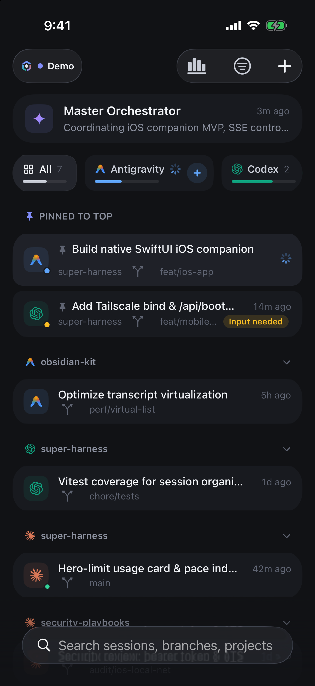
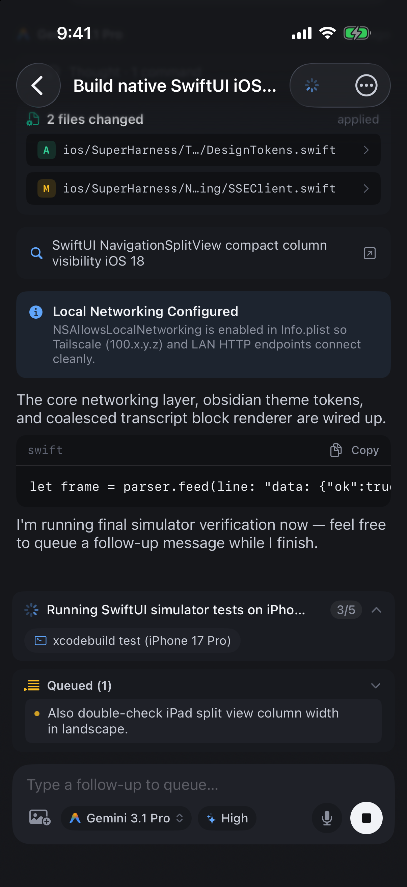
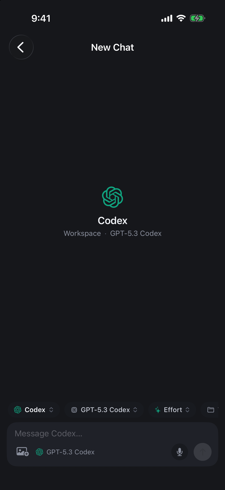

# Super Harness


A calm, high-performance Electron desktop multiplexer and control plane for local AI coding harnesses — unifying **OpenAI Codex** (Desktop + app-server daemon + CLI), **Claude** (Desktop + Code CLI + `tmux --remote-control`), **Google Antigravity** (Desktop + CLI via ACP), and **Meta Muse** (`muse exec` + live terminal sessions) under one cohesive interface.

## Highlights

- **Non-destructive multiplexing**: Native harnesses remain the source of truth for their own transcripts, auth, sandboxes, and daemons. Super Harness reads their local stores and dispatches back through each harness's official protocol (`codex exec resume --remote unix://`, `claude --resume` / `tmux send-keys`, `agy acp`, `muse exec --session-id` / `muse session-message send`).
- **Coalesced visual grammar**: Thinking traces, shell commands, unified file diffs, MCP tool calls, web searches, interactive/answered questions, image attachments, and queued messages render with one calm obsidian design system.
- **Universal message queue**: Queue follow-up prompts while any harness is working (plus mirror native Codex/Claude queues), with Send-now, Edit, and Delete controls.
- **Instant chat switching**: Progressive UTF-8-safe JSONL tail reader (handles 500 MB+ transcripts in milliseconds), pooled read-only SQLite + indexed Codex tail queries, two-tier LRU transcript caching (main + renderer stale-while-revalidate), hover/idle prefetching, and LRU Markdown rendering.
- **Master Orchestrator + MCP Control Plane**: A pinned orchestrator thread backed by your choice of harness, wired via a loopback-only authenticated Control HTTP Server + bundled stdio MCP server (`src/mcp/server.ts`) to inspect sessions, dispatch prompts, organize folders/pins, and update settings.
- **2-up Split View & live `tmux` mirror**: Monitor and drive two sessions side-by-side or flip any `tmux`-backed Claude thread into a live terminal mirror.
- **Usage & spend telemetry**: Hover any harness tab for live quota bars (Claude/Codex/Muse via `muse usage`), 5h/24h/7d/14d API-equivalent spend, 7-day sparklines, and quick links to account usage pages.
- **Native SwiftUI iOS Companion (`ios/`)**: Drive every local harness from your iPhone over Tailscale or LAN with live SSE delta sync, optimistic message delivery, collapsible project sections, interactive diff/tool cards, usage telemetry, and low-latency YapYap voice dictation.
- **Design System + Storybook 8**: Reusable semantic tokens (`src/renderer/ui/tokens.css`), UI primitives (`src/renderer/ui/`), and interactive stories.

## iOS Companion

Super Harness includes a native SwiftUI iOS companion app (`ios/`, zero third-party dependencies) that connects to the desktop host's authenticated Mobile API (`Settings → Master agent → Mobile companion API`, default port `47890`) over Tailscale or LAN.

<table>
  <tr>
    <td align="center"><br /><sub><b>Sessions &amp; Live Activity</b></sub></td>
    <td align="center"><br /><sub><b>Coalesced Transcript &amp; Queue</b></sub></td>
    <td align="center"><br /><sub><b>Inline New Chat &amp; Dictation</b></sub></td>
  </tr>
</table>

- **Real-time Protocol v2 sync**: Gzipped `/api/bootstrap`, incremental `sessions_delta` SSE updates with `Last-Event-ID` replay, per-client scoped transcript streaming, and live busy spinners across harnesses and folders.
- **Snappy mobile UX**: Instant optimistic outgoing bubbles with retry reconciliation, pinned bottom-anchored transcripts with geometric `↓ Latest` hysteresis, collapsible sections with rounded swipeable row cards, and built-in Demo Mode.
- **Voice dictation**: On-device 16 kHz WAV capture proxied through `/api/dictate` to a local YapYap / Whisper server.
- **Build & run**: Requires Xcode and [XcodeGen](https://github.com/yonaskolb/XcodeGen) (`cd ios && xcodegen generate && open SuperHarness.xcodeproj`, or run `ios/scripts/install-device.sh` to sign and install to a connected iPhone). See [ios/IOS_ARCHITECTURE.md](./ios/IOS_ARCHITECTURE.md) and [ios/MOBILE_API_CONTRACT.md](./ios/MOBILE_API_CONTRACT.md) for details.

## Architecture

See [ARCHITECTURE.md](./ARCHITECTURE.md) for the full design and module boundaries.

```
src/
├── main/
│   ├── adapters/       # Cohesive HarnessDriver contract + Codex / Claude / Antigravity / Muse drivers + Registry
│   ├── services/       # Dispatcher, LiveSyncService (inotify), TranscriptCache, UsageService, MasterEngine, ControlServer, AgyAcpPool
│   ├── store/          # Persistent Super Harness settings, folders, pins & overrides (~/.config/super-harness)
│   └── utils/          # Progressive JSONL tailReader, pooled read-only SQLite helper, system/process discovery
├── mcp/                # Standalone stdio MCP server bridging Master Orchestrator -> ControlServer
├── renderer/
│   ├── ui/             # Obsidian design tokens, primitives, and Storybook stories
│   ├── components/     # Sidebar, SessionPane, SessionHeader, SessionComposer, CoalescedBlockView, SettingsModal, etc.
│   └── utils/          # Renderer LRU transcript cache, LRU Markdown renderer, pure sidebarGrouping
└── shared/             # Shared IPC & domain types
tests/                  # Vitest unit, adapter parity, and performance regression suites
ios/                    # Native SwiftUI iOS companion app, unit tests, and live Simulator E2E tests
docs/ios/               # iOS companion screenshots
```

## Development

```bash
# Install dependencies (use --ignore-scripts if relying on system Electron)
npm install

# Typecheck
npm run typecheck

# Run unit & performance regression test suite
npm test

# Build main + renderer
npm run build

# Launch desktop app
npm start

# Run Storybook 8 (http://localhost:6006)
npm run storybook

# Benchmark live local transcript loading & caching
npm run bench
```

## License

MIT
